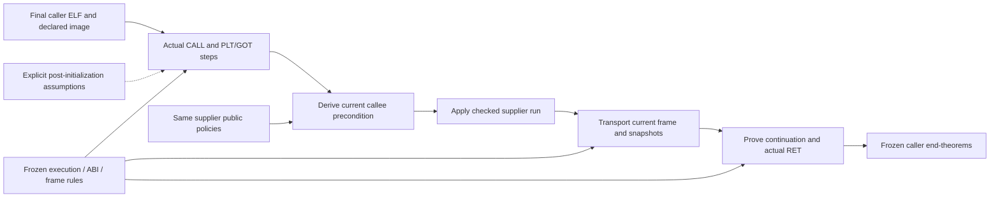

# Reading the composition boundary

This diagram is explanatory. Literal statements and their fresh kernel reconstruction control the claims; arrows here are not proof certificates.

C1 interprets a single comparison result. C2 keeps initial equality across conditional cleanup and proves both memory-effect branches. C3 retains initial equality, always clears, then compares the current memory including admitted aliases. Its second input snapshot must follow the cleanup effect; its incoming return slot at `S` must remain distinct from cleanup's return slot at `S−48`.

The supplier proof chain is rebuilt during checking. Caller construction applies the exported public policies and proves its call-site premises and continuations. The inspection evidence does not turn the ambient ML namespace into a formally isolated capability boundary.

Concrete addresses, instruction sites, stack slots, snapshots and branch states remain caller facts. The C3 MOV offset-73 site proof uses existing instruction semantics and step algorithms; the predeclared extension-policy interpretation remains subject to human review. The original capped held-out trial and accepted successor remain different observations.

Loaded-image/linkage assumptions describe the state after initialization. They do not assume the comparison/cleanup result or prove the dynamic loader. Byte extraction and integrity checks are separate trusted evidence; they do not validate architectural semantics. The whole-run checked policies cover every successor, including intermediate accesses and the actual return, within the declared model.
